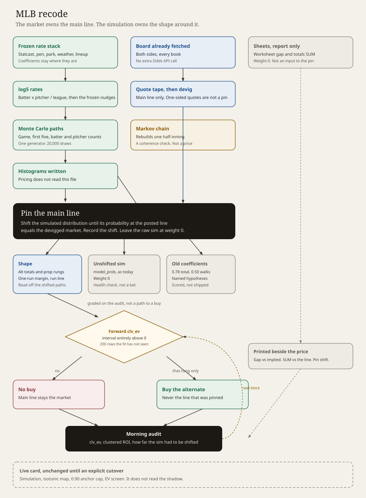
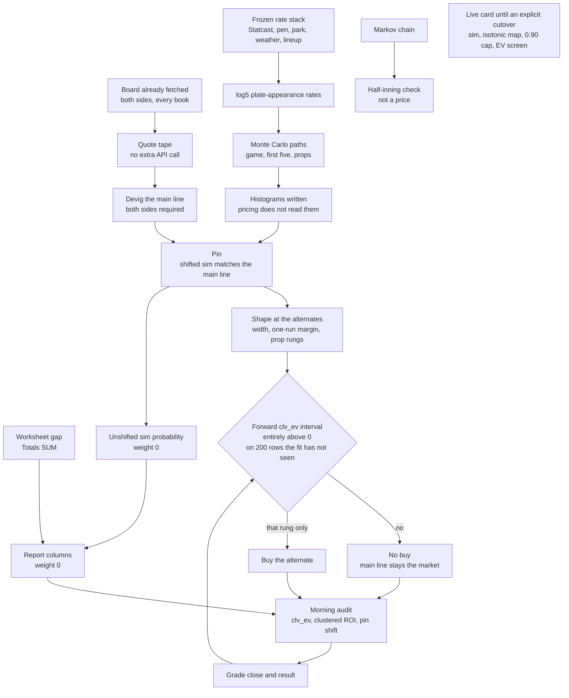

# MLB engine recode — master plan

The live card stays the live card until an explicit cutover. This plan adds a
shadow price beside it. The Monte Carlo keeps generating the distribution. The
devigged market becomes the probability at the main line. A bet exists only
where the shape around that line beats the market's own alternate on closing
expected value, on a forward sample the fit has not seen.

Labels: **[MEASURED]** the `engine-state` ledgers and the studies already in
this tree · **[DEFAULT]** a starting rule, changed only by the review in §8 ·
**[HYPOTHESIS]** must clear that review before it prices.

The summer book this plan is answering: 3,618 buys, 1,635–1,969–14, **−334.8
units, −9.3%**, 61 slates from 2026-07-19 through 2026-09-30. A date-clustered
95% interval on that ROI is about **[−13.3%, −4.8%]**. August onward, every buy
carrying a devigged price, is −6.2% with an interval about **[−11.3%, −1.7%]**
[MEASURED]. October has ledger rows through the 11th and zero buys.

Closing line value on 1,925 of those buys is **+0.17 percentage points**
(interval about [+0.05, +0.34]) and 57% beat the close. The money version,
`clv_ev`, is **−3.6 cents per unit**. Only 7.5% of those rows have a positive
`clv_ev`. Of the 1,102 that beat the close, 111 did so by enough to cover the
price taken, and that subset still returned −2.6% [MEASURED]. Beating the close
by a fraction of a point is smaller than the hold.

---

## 0. The decision

The simulation is hot, and the sheets already showed it. On 133 graded games the
Markov first-five chain projected 5.99 runs, the simulator 5.70, and the games
scored 4.85. The simulator's Brier on those totals was better by about 0.005
[MEASURED, `Config.f5_from_sim`]. On the totals sheet from 2026-09-11 through
2026-10-11 the sim median sat above the posted total on 147 of 164 games, by
**+1.03 runs**, and that gap correlated **−0.01** with how far the game finished
from the line [MEASURED, `totals_ledger.csv`].

So the recode does not replace the plate-appearance simulation with a
basketball-style curve, and it does not add another Statcast multiplier to chase
the mean. It pins the main line and keeps the paths.

```
shadow probability at the main line  =  devigged market probability
shadow probability at an alternate   =  the sim distribution, shifted until
                                         the main line matches, then read at
                                         the alternate
unshifted sim probability            =  a report column, weight 0
```

`MARKET_ANCHOR_CAP` (0.90) does the reverse of this. It pulls a fitted weight of
1.0 or 0.99 back to 0.90 so a 20-point disagreement can still buy
[MEASURED, `config.py`]. The shadow price has no cap, because the main line is
not a disagreement.

---

## 1. What stays

| Piece | Role in the recode |
|---|---|
| Monte Carlo, 20,000 paths (`mlb_engine/models/montecarlo.py`) | The only run generator. One set of paths carries the final score, the first five, and every batter and pitcher count. |
| log5 matchup and the current rate stack (`pipeline.py`, `features/rolling.py`) | Frozen. Park, weather, umpire, arsenal, platoon, expected home runs, barrel slopes, and tail shrinks stay at today's coefficients. A new multiplier ships only as a shape change after the pin, and only through §8. |
| Baserunning transitions shared by the chain and the sim | Kept. The chain uses them as a unit check (§3). |
| Two-sided devig, `p / (p + q)` (`market/ev.py`) | The pin and the historical `fair_prob` stay on the same definition, so shadow CLV can be compared with the ledger. |
| No-buy markets `batter_h`, `batter_hr`, `batter_hrr`, `batter_r`, `batter_tb` | Stay off the buy list. Quoted and graded. |
| `one_side_per_prop` | The shadow ledger counts one row per wager. |
| Worksheet and totals sheet | Stay research. Their scores do not enter the pin (§6). |
| Live `pipeline.py` bet path | Unchanged until Phase 4. The card the desk gets is still the current card. |

## 2. What retires, at cutover

| Piece | Why it leaves the price |
|---|---|
| `anchor_to_market` as the bet probability | Blends the side probability after the sim, which deletes the shape along with the level. The pin replaces it. |
| `MARKET_ANCHOR_CAP` | Reopens markets the shrink study had shut. |
| Per-market anchors 0.78 (game total), 0.50 (pitcher walks), 0.61 (doubles), 0.81 (pitcher hits), and the 0.99s | [HYPOTHESIS] named in §5. They do not ride into the shadow price. Game-total buys were +10.6% on 124 and `clv_ev` −2.8¢; pitcher walks were +7.8% on 61, CLV +0.36pp, `clv_ev` −5.7¢; doubles were 24–114 at about +490 with CLV −0.22pp [MEASURED]. |
| Markov chain as the first-five price (`f5_from_sim` defaults off) | The hotter of the two hot models, and it never sees the hook or the pen. First-five moneylines went −21% on 106 buys [MEASURED]. |
| Isotonic calibration on the bet | Fit to pull the hot sim back toward results. A probability whose main line is the market does not want that map. The map stays on the unshifted sim, as the health check. |
| Singles and RBI as buys | No price band survived: singles −8.9% on 424, RBI −11.0% on 403 [MEASURED]. They join the no-buy list at cutover. Until then the live list is untouched. |

The Markov chain stays in the tree. After each shadow run it rebuilds one
half-inning from the same transitions. A break there is a baserunning bug. It
is not a forecast, and its times-through factors (1.00, 1.03, 1.08, 1.10) are
not tuned.

---

## 3. The pin

For one market with a two-sided main line:

1. The sim produces the empirical distribution of the statistic (runs, margin,
   strikeouts, hits, walks, outs).
2. The board produces one devigged probability at the main line, from the
   two-sided quotes already in memory. A one-sided quote is not a pin. The row
   is marked `unpinned` and cannot be a buy. One-way buys were the worse half
   of the old book.
3. The distribution is shifted along its own support until its probability on
   the main-line side equals that devigged probability. Variance and skew move
   only as the shift forces them to. The shift is recorded (`pin_shift`).
4. Every other posted line in that market is read off the shifted distribution.
   The difference between that read and the devigged price of the alternate is
   the shape residual.
5. The unshifted probability is stored as `model_prob`. Its weight is 0. It
   does not enter expected value.

A game total pinned at 8.5 has no bet at 8.5. The shadow bet, if one exists, is
at 7.5 or 9.5 or whatever alternate the book posted, and only after §8. A
moneyline pin leaves the run line as the shape: `P(margin = 1)` and
`P(margin > 1.5)` given the pinned side and the pinned total. That residual is
how the run line is priced. It starts at weight 0. Historical run-line `clv_ev`
was about −1.4 cents [MEASURED].

A prop is pinned on its own line, not by shifting the final score and hoping the
count follows. Strikeouts move onto the strikeout line. Walks move onto the walk
line. The joint with the game total is kept from the same paths, so an alternate
is still conditional on the game the totals pin just set.

The first five are the first five innings of those same paths, then pinned to
the first-five market. There is one generator.

---

## 4. The tape

There is no database under the engine today. State is JSON caches plus the
`engine-state` branch: predictions, one closing JSON per slate, the ledger.
The close is one consensus quote keyed by matchup text (`audit/clv.py`
`quote_key`). That key attached a −2000 close to Athletics +242 at Boston on
2026-08-08 and produced a +60 percentage-point CLV on a row whose model
probability was 0.17 [MEASURED]. Dropping it takes the moneyline CLV mean from
+0.69pp to −0.30pp.

The tape is append-only, written from quotes the run has already fetched. It
does not add an Odds API call. One row is:

```
event_id, game_pk, market, side, line, book, american, opposite_american,
pass_id, captured_at, source
```

`event_id` is the Odds API id when the board has one, otherwise `game_pk`.
Names are display only. Both sides are required. A close is the last pre-pitch
row for that key. A close is quarantined, and left out of CLV, when either side
is missing or the no-vig move from the bet-time quote exceeds **15 percentage
points** unless the other side of the same quote moved with it [DEFAULT]. The
15-point band is wide enough to keep a real steam move and tight enough to drop
the +242 / −2000 join. The review can move the band. It cannot turn a
quarantined close into a make-good.

CLV keeps today's definition, labeled: consensus no-vig at the close minus
consensus no-vig at the bet, and `clv_ev` is the expected value of the American
price taken under the closing no-vig. Once the tape has a book on the row, a
second pair is stored for that book. The headline number stays the consensus
pair until the review says the book pair is the one being graded. The two are
never averaged.

July 2026 has no close on the buy ledger (0 of 1,272). Those rows are not
backfilled. The shadow sample starts the day the tape starts.

---

## 5. Markets

| Market | Shadow price | Buy |
|---|---|---|
| Game total, F5 total | Pin the main line. Alts from the shifted run distribution. | Main line never. An alt only after §8. |
| Moneyline, F5 moneyline | Pin. No alternate exists. | No buy. The pin is the price. |
| Run line, F5 run line | Conditional margin from the pinned moneyline and total. | Weight 0 until §8. |
| Pitcher K, outs, hits, walks, ER | Pin each prop's own main line. Alts from that prop's shifted counts. | Main line never. Alts after §8. |
| Batter hits, HR, HRR, runs, total bases | Graded, not bought. | No-buy list, already live. |
| Singles, RBI | Graded, not bought, at cutover. | Floors left no pocket [MEASURED]. Live list unchanged until Phase 4. |
| Doubles, batter walks | Pinned and graded. | The 0.61 and 0.90 coefficients do not carry. |

The old anchors are recorded as named hypotheses (`game_total` 0.78,
`pitcher_bb` 0.50, `pitcher_h` 0.81, `batter_2b` 0.61). Each is a shadow column:
the unshifted sim, shrunk by that alpha, scored on `clv_ev` against the pin.
None of them is the price. Refitting them on the ledger they were fit on is
forbidden. The shrink study already did that through 2026-09-09.

A shape bet has to clear the same screens the card uses today for a real quote:
two-sided line, price ceiling, and the edge measured against the **alternate's**
devigged price, not against the main line the pin already matched. `min_edge`
stays 0.02 [DEFAULT]. Lowering it to refill the card is the change the cap
replay already rejected: at a 0.80 cap the added buys came back with the loss.

Strong and Moderate stay a rank of fair probability for display. They do not
change stake. The ledger's Strong-versus-Moderate gap is mostly the old edge
ranking; under the fair-probability rule September has 22 Strong buys
[MEASURED]. That is not a sizing result.

Posted versus projected lineups stay a grade flag. Posted went −3.8% (770) and
projected −11.3% (705), and posted `clv_ev` was still about −4 cents [MEASURED].
A posted lineup makes the row's grade usable. It does not raise the weight.

---

## 6. The sheets

The worksheet (194 games, 2026-09-14 through 2026-10-11) and the totals sheet
(253 games, 2026-09-11 through 2026-10-11) stay beside the card
[MEASURED, `worksheet_ledger.csv`, `totals_ledger.csv`].

Totals SUM correlates **−0.005** with runs minus the line. The sign hit 53.3%
(120–105), interval about 47–60%, against a 52.4% break-even at −110. The slate
went over 57% of the time. Under leans hit 44%. Absolute SUM of 10 or more hit
under 50%. The watch rows (SUM +5..14 on a total of 8.5 or lower, and the under
mirror) are 59% and 47%, both intervals covering break-even. They remain bold
on the sheet and off the buy list.

The worksheet's current weights cover 51 games. Absolute gap correlates
**−0.04** with win rate minus the market's implied probability. Across every
weight version the sheet's favorite was the shorter price in 114 of 152 games.
Betting the sheet when it took the dog was −25% on 38.

Both numbers are printed on the shadow row: `worksheet_gap` next to the no-vig
win probability of the side it favors, and `totals_sum` next to the posted total
and `pin_shift`. Weight 0. `market_p_over` is blank on 165 of 253 totals rows;
the tape fills it forward. The historical blanks are not invented.

---

## 7. The audit

The morning report opens on three lines:

1. `clv_ev` in cents, with the date-clustered 95% interval, and the count.
2. ROI on decided shadow bets, with the same clustered interval. Empty when
   nothing was bought, which is the expected state.
3. The pin health: mean `pin_shift` by market, and the share of sim medians that
   sat above the posted total. A shift that stays near +1 run on totals is the
   sim staying hot, which is a reason to keep the weight at 0.

Under those, in this order: shape-residual mean at the alternates, worksheet gap
versus the implied probability, totals SUM versus the line, and the unshifted
sim's Brier against the market's Brier. The 57% "beat the close" rate is a
footnote under the CLV definition, not the headline. PPV and NPV stay in the
workbook and leave the first screen.

A quarantined close is counted in the tape and omitted from every CLV line. The
report prints the quarantine count.

---

## 8. When a weight may leave zero

A market, or one alternate rung inside a market, leaves weight 0 only when all
of these hold on rows the hypothesis did not see:

- At least **200** decided forward rows [DEFAULT].
- The date-clustered 95% interval for `clv_ev` lies entirely above 0.
- The same interval computed on the main-line pin alone does not. A rung that
  wins because the main line moved is a level bet in disguise, and the level
  belongs to the market.
- The review is a person reading that block. The script prints the interval and
  does not write a new weight by itself.

Until then the shipped weight is 0, the bet probability at the main line is the
market, and the card buys nothing in that market. That is the October card, on
purpose.

The block is four weeks or 200 rows, whichever comes later. A single slate
cannot clear it. The old ledger cannot clear it either.

---

## 9. Phases

Each phase is a separate change. Phases 1–3 do not change a tier, a stake, or a
cell on the card.

### Phase 1 — Write what the run already has

One write-only hook after the simulation and after the board is in memory.
It appends the quote tape (§4) and the sim histograms (counts by market, not the
20,000 paths). Pricing does not read either file. No new Odds API request. No
change to `model_prob`, `bet_prob`, or tier.

The histograms are enough to rebuild the pin without a second simulation, so
the shadow and the card are looking at the same paths.

### Phase 2 — `mlb-engine shadow`

A command that reads the tape and the histograms and writes
`shadow_ledger.csv`. It applies §3. It does not call `classify`. It does not
send a card. Columns include `model_prob`, `fair_prob`, `pin_shift`,
`shape_residual` at each posted alternate, `worksheet_gap`, `totals_sum`, and
the quarantine flag.

### Phase 3 — Grade the shadow

The morning audit gains the §7 block, fed by the shadow ledger and the tape.
The existing PPV report is left in place so the live card's receipt does not
move. Shadow rows that were not bought are still graded, because the thing
being measured is the residual, not a ticket.

### Phase 4 — Cutover, only when asked

After a market clears §8, that market's bet probability becomes the shifted
distribution at the alternate that cleared, and the main line stays the market.
Markets that have not cleared stay pinned and unbought. Singles and RBI join
the no-buy list in this same change. The Markov chain leaves the first-five
price. `anchor_to_market` leaves the bet path.

Phase 4 is not implied by shipping Phases 1–3. It waits for an explicit ask
and for a market whose interval has cleared. If none clears, the live card
remains the live card and the shadow remains the record.

---

## 10. What this plan will not do

- It will not spend Odds API credits to reprice the summer.
- It will not build a plate-appearance warehouse. The missing store is the
  quote tape.
- It will not import a power devig, a basketball foul model, or another
  engine's anchor file. A power-devig comparison can be a shadow column later.
  It is not the pin.
- It will not lower `min_edge`, lift the 0.90 cap, or reopen hits, home runs,
  HRR, runs, or total bases.
- It will not refit the isotonic map onto the pinned probability.
- It will not feed worksheet gap or totals SUM into the shift.
- It will not size Strong above Moderate.
- It will not change `engine_common` or any other sport.

---

## 11. Workflow

The chart is the pricing path. The grey band at the bottom is the live card,
which does not read the shadow until Phase 4.



The editable chart is [`recode_workflow.svg`](recode_workflow.svg).


