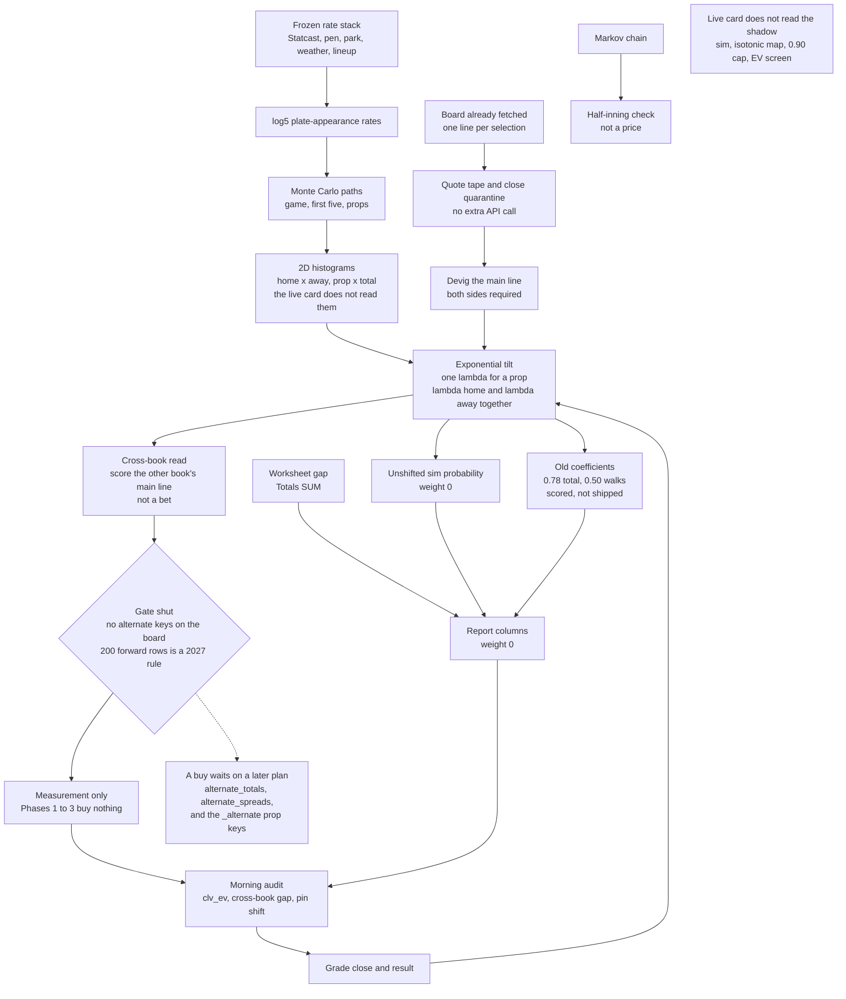

# MLB engine recode — master plan

The live card stays the live card. This plan measures a shadow price beside it.
The Monte Carlo keeps generating the distribution. An exponential tilt moves
that distribution until the main line matches the devigged market. Phases 1–3
buy nothing. The board this engine fetches has one line per selection, so there
is no alternate for a gate to test, and the 200-row rule cannot clear in 2026.

Labels: **[MEASURED]** the `engine-state` ledgers and the studies already in
this tree · **[DEFAULT]** a starting rule, changed only by the review in §8 ·
**[HYPOTHESIS]** must clear that review before it prices.

The summer book this plan is answering: 3,618 buys, 1,635–1,969–14, **−334.8
units, −9.3%**, 61 slates from 2026-07-19 through 2026-09-30. A date-clustered
95% interval on that ROI is about **[−13.3%, −4.8%]**. August onward, every buy
carrying a devigged price, is −6.2% with an interval about **[−11.3%, −1.7%]**
[MEASURED]. October has ledger rows through the 11th and zero buys.

Closing line value on 1,925 of those buys is **+0.17 percentage points**
(interval about [+0.05, +0.34]) and 57% beat the close. The money version,
`clv_ev`, is **−3.6 cents per unit**. Only 7.5% of those rows have a positive
`clv_ev`. Of the 1,102 that beat the close, 111 did so by enough to cover the
price taken, and that subset still returned −2.6% [MEASURED]. Beating the close
by a fraction of a point is smaller than the hold.

---

## 0. The decision

The simulation is hot, and the sheets already showed it. On 133 graded games the
Markov first-five chain projected 5.99 runs, the simulator 5.70, and the games
scored 4.85. The simulator's Brier on those totals was better by about 0.005
[MEASURED, `Config.f5_from_sim`]. On the totals sheet from 2026-09-11 through
2026-10-11 the sim median sat above the posted total on 147 of 164 games, by
**+1.03 runs**, and that gap correlated **−0.01** with how far the game finished
from the line [MEASURED, `totals_ledger.csv`].

So the recode does not replace the plate-appearance simulation with a
basketball-style curve, and it does not add another Statcast multiplier to chase
the mean. It pins the main line and keeps the paths.

```
shadow probability at the main line  =  devigged market probability
shadow read at a second line         =  the sim distribution, exponentially
                                         tilted until the main line matches,
                                         then read at that second line
unshifted sim probability            =  a report column, weight 0
```

A second line, in this plan, is another book's main line for the same
selection. It is the cross-book check in §3. It is not an alternate rung, and
it is not a bet. True alternates are separate Odds API market keys the client
does not request (§5).

`MARKET_ANCHOR_CAP` (0.90) does the reverse of this. It pulls a fitted weight of
1.0 or 0.99 back to 0.90 so a 20-point disagreement can still buy
[MEASURED, `config.py`]. The shadow price has no cap, because the main line is
not a disagreement.

---

## 1. What stays

| Piece | Role in the recode |
|---|---|
| Monte Carlo, 20,000 paths (`mlb_engine/models/montecarlo.py`) | The only run generator. One set of paths carries the final score, the first five, and every batter and pitcher count. |
| log5 matchup and the current rate stack (`pipeline.py`, `features/rolling.py`) | Frozen. Park, weather, umpire, arsenal, platoon, expected home runs, barrel slopes, and tail shrinks stay at today's coefficients. A new multiplier ships only as a shape change after the pin, and only through §8. |
| Baserunning transitions shared by the chain and the sim | Kept. The chain uses them as a unit check (§3). |
| Two-sided devig, `p / (p + q)` (`market/ev.py`) | The pin and the historical `fair_prob` stay on the same definition, so shadow CLV can be compared with the ledger. |
| No-buy markets `batter_h`, `batter_hr`, `batter_hrr`, `batter_r`, `batter_tb` | Stay off the buy list. Quoted and graded. |
| `one_side_per_prop` | The shadow ledger counts one row per wager. |
| Worksheet and totals sheet | Stay research. Their scores do not enter the pin (§6). |
| Live `pipeline.py` bet path | Unchanged until Phase 4. The card the desk gets is still the current card. |

## 2. What retires, at cutover

| Piece | Why it leaves the price |
|---|---|
| `anchor_to_market` as the bet probability | Blends the side probability after the sim, which deletes the shape along with the level. The pin replaces it. |
| `MARKET_ANCHOR_CAP` | Reopens markets the shrink study had shut. |
| Per-market anchors 0.78 (game total), 0.50 (pitcher walks), 0.61 (doubles), 0.81 (pitcher hits), and the 0.99s | [HYPOTHESIS] named in §5. They do not ride into the shadow price. Game-total buys were +10.6% on 124 and `clv_ev` −2.8¢; pitcher walks were +7.8% on 61, CLV +0.36pp, `clv_ev` −5.7¢; doubles were 24–114 at about +490 with CLV −0.22pp [MEASURED]. |
| Markov chain as the first-five price (`f5_from_sim` defaults off) | The hotter of the two hot models, and it never sees the hook or the pen. First-five moneylines went −21% on 106 buys [MEASURED]. |
| Isotonic calibration on the bet | Fit to pull the hot sim back toward results. A probability whose main line is the market does not want that map. The map stays on the unshifted sim, as the health check. |
| Singles and RBI as buys | No price band survived: singles −8.9% on 424, RBI −11.0% on 403 [MEASURED]. They join the no-buy list at cutover. Until then the live list is untouched. |

The Markov chain stays in the tree. After each shadow run it rebuilds one
half-inning from the same transitions. A break there is a baserunning bug. It
is not a forecast, and its times-through factors (1.00, 1.03, 1.08, 1.10) are
not tuned.

---

## 3. The pin

The tilt is the model. A location shift and a mean rescale are different prices
on a count that starts at 0, so the plan picks one and does not leave it as
"shift along the support."

The adjustment is an exponential tilt of the simulated histogram. For a
one-constraint prop with count `k` and sim probability `p(k)`:

```
p_λ(k)  ∝  p(k) · exp(λ · k)
```

`λ` is solved so the tilted over probability at the main line equals the
devigged market probability. The solve is one-dimensional and monotone. `λ` is
what gets stored as `pin_shift`. The tilt stays on the sim's support, so a walk
or a strikeout cannot go negative, and it stays on the integer lattice.

A location shift is rejected because a count bounded at 0 either gains negative
mass or, once that mass is cut off, no longer hits the market probability. A
mean rescale is rejected because multiplying an integer count leaves the
lattice unless a second rounding rule is invented. Those two are not shadowed.

The moneyline and the total are two constraints on one joint, solved together.
Phase 1 stores the home-run × away-run histogram (§9). The tilt is

```
p(h, a)  ∝  p_sim(h, a) · exp(λ_h · h + λ_a · a)
```

`λ_h` and `λ_a` are solved as a pair so the tilted total-over probability and
the tilted home-win probability match the two devigged main lines at once.
Equivalently, one parameter tilts the sum and the other tilts the margin. The
sim's dependence between the two teams is the base measure. Independent
one-dimensional shifts of home runs and away runs are not used, because they
throw that dependence away and the run line is the dependence.

A full-game moneyline is two-way, so the win constraint is
`P(home > away) / (P(home > away) + P(away > home))`. Tie mass in the histogram
stays in the histogram. The first five, which the books price with a tie, use
the three-way probabilities the same pair of tilts produces. If no pair can hit
both targets, the game is `unpinned`.

For a prop, the stored joint is that prop's count × the full-game total. The
prop's own `λ` is solved on the count. The total axis keeps the total-tilt
already solved on the home × away histogram, so the prop read is conditional on
the pinned game rather than on a second, conflicting total. A prop whose main
line cannot be hit on its support is `unpinned`.

What the tilted distribution is read against, in this plan, is the other line
already on the board: a second book's main number for the same selection. Pin
to the consensus line, read the tilted probability at the other book's line,
and store the gap against that book's own devigged price as `cross_book_gap`.
That is the test of the tilt, and it runs before any forward block. A second
book's main line is the soft-book difference the summer props already lost. It
is a measurement column. It is not an alternate, and it does not enter a bet.

The run line is read off the tilted home × away joint:
`P(margin > 1.5)` against the posted run line. That residual is a column.
Historical run-line `clv_ev` was about −1.4 cents [MEASURED]. It is not a buy
in this plan.

The same two knobs can pin either other pair and hold one market out. That
rotation is a check, not a second test, and it does not replace this pin.
Holding out the moneyline, with the total and the run line pinned, asks the
same one-run question from the other side. The two gaps should agree in sign.
A disagreement means the solver or the histogram is wrong, so that holdout is
stored under the run-line line. Holding out the total spends both knobs on the
margin. A gap there means the pin had to distort scoring to make the two side
prices true together. It is counted and left off the first screen. The
flattering rotation does not become the pin, and none of the three reads is a
ticket.

The unshifted probability is stored as `model_prob`. Its weight is 0. A
one-sided quote is not a pin. The row is `unpinned`.

The first five are the first five innings of the same paths, stored as their
own home × away histogram, then tilted to the first-five moneyline and total.
There is one generator.

---

## 4. The tape

There is no database under the engine today. State is JSON caches plus the
`engine-state` branch: predictions, one closing JSON per slate, the ledger.
The close is one consensus quote keyed by matchup text (`audit/clv.py`
`quote_key`). That key attached a −2000 close to Athletics +242 at Boston on
2026-08-08 and produced a +60 percentage-point CLV on a row whose model
probability was 0.17 [MEASURED]. Dropping it takes the moneyline CLV mean from
+0.69pp to −0.30pp.

The tape is append-only, written from quotes the run has already fetched. It
does not add an Odds API call. One row is:

```
event_id, game_pk, market, side, line, book, american, opposite_american,
pass_id, captured_at, source
```

`event_id` is the Odds API id when the board has one, otherwise `game_pk`.
Names are display only. Both sides are required. A close is the last pre-pitch
row for that key. A close is quarantined, and left out of CLV, when either side
is missing or the no-vig move from the bet-time quote exceeds **15 percentage
points** unless the other side of the same quote moved with it [DEFAULT]. The
15-point band is wide enough to keep a real steam move and tight enough to drop
the +242 / −2000 join. The review can move the band. It cannot turn a
quarantined close into a make-good.

CLV keeps today's definition, labeled: consensus no-vig at the close minus
consensus no-vig at the bet, and `clv_ev` is the expected value of the American
price taken under the closing no-vig. Once the tape has a book on the row, a
second pair is stored for that book. The headline number stays the consensus
pair until the review says the book pair is the one being graded. The two are
never averaged.

July 2026 has no close on the buy ledger (0 of 1,272). Those rows are not
backfilled. The shadow sample starts the day the tape starts.

---

## 5. Markets

The client requests `_GAME_MARKETS` (`h2h`, `spreads`, `totals`), `_F5_MARKETS`
(the three first-five keys), and `DEFAULT_PROP_MARKETS`
(`mlb_engine/data/oddsapi.py`). One region, `us`. The vendor bills market keys
times regions, and a market that returns no book is not billed. The stored
board keeps one line per selection. On a live slate the game total, moneyline,
run line, walks, earned runs, outs, and pitcher hits each have a single line.
A second number, when one appears, is another book's main line — a 6.5 at one
book beside a 7.5 everywhere else — not a ladder.

The vendor does publish alternate keys. They are not requested, and this plan
does not add them:

| Key | What it would add | Where it is billed |
|---|---|---|
| `alternate_spreads`, `alternate_totals` | Full-game run-line and total ladders | The bulk odds request, two extra keys |
| `alternate_spreads_1st_5_innings`, `alternate_totals_1st_5_innings` | First-five ladders | Per event |
| `pitcher_strikeouts_alternate`, `pitcher_outs_alternate`, `pitcher_hits_allowed_alternate`, `pitcher_walks_alternate`, `pitcher_earned_runs_alternate` | Pitcher ladders | Per event, one credit per key per game at `regions=us` |
| `batter_hits_alternate`, `batter_total_bases_alternate`, `batter_home_runs_alternate`, `batter_hits_runs_rbis_alternate`, and the rest of the `*_alternate` batter keys | Batter ladders | Per event, same billing |

A 15-game slate that added one pitcher-alternate key would spend about 15
credits a pass on top of the props it already buys. Adding the batter set
multiplies that by the number of keys. That spend is a later decision, with
its own plan, after the tilt has been scored on the cross-book gaps that
already exist. It is not part of Phases 1–3.

| Market | What the shadow records | Buy in this plan |
|---|---|---|
| Game total, F5 total | Tilt the joint onto the main line. | None. No alternate total is fetched. |
| Moneyline, F5 moneyline | The same joint tilt, second constraint. | None. The pin is the price. |
| Run line, F5 run line | `P(margin)` off that joint, against the one posted line. | None. One line is not a rung. |
| Pitcher K, outs, hits, walks, ER | One-parameter tilt on the count, total axis held from the game tilt. | None. |
| Batter hits, HR, HRR, runs, total bases | Graded, not bought. | No-buy list, already live. |
| Singles, RBI | Graded. | No-buy at a future cutover. Floors left no pocket: singles −8.9% on 424, RBI −11.0% on 403 [MEASURED]. The live list is unchanged. |
| Doubles, batter walks | Tilted and graded. | The 0.61 and 0.90 coefficients do not carry. |

The old anchors are recorded as named hypotheses (`game_total` 0.78,
`pitcher_bb` 0.50, `pitcher_h` 0.81, `batter_2b` 0.61). Each is a shadow column:
the unshifted sim, shrunk by that alpha, scored on `clv_ev` against the pin.
None of them is the price. Refitting them on the ledger they were fit on is
forbidden. The shrink study already did that through 2026-09-09.

There is no shape bet in this plan, so `min_edge` is not applied to one.
`min_edge` stays 0.02 on the live card [DEFAULT]. Lowering it to refill that
card is the change the cap replay already rejected: at a 0.80 cap the added
buys came back with the loss. If a later plan fetches the alternate keys
above, a rung would be screened against that rung's own devigged price, not
against the main line the tilt already matched.

Strong and Moderate stay a rank of fair probability for display. They do not
change stake. The ledger's Strong-versus-Moderate gap is mostly the old edge
ranking; under the fair-probability rule September has 22 Strong buys
[MEASURED]. That is not a sizing result.

Posted versus projected lineups stay a grade flag. Posted went −3.8% (770) and
projected −11.3% (705), and posted `clv_ev` was still about −4 cents [MEASURED].
A posted lineup makes the row's grade usable. It does not raise the weight.

---

## 6. The sheets

The worksheet (194 games, 2026-09-14 through 2026-10-11) and the totals sheet
(253 games, 2026-09-11 through 2026-10-11) stay beside the card
[MEASURED, `worksheet_ledger.csv`, `totals_ledger.csv`].

Totals SUM correlates **−0.005** with runs minus the line. The sign hit 53.3%
(120–105), interval about 47–60%, against a 52.4% break-even at −110. The slate
went over 57% of the time. Under leans hit 44%. Absolute SUM of 10 or more hit
under 50%. The watch rows (SUM +5..14 on a total of 8.5 or lower, and the under
mirror) are 59% and 47%, both intervals covering break-even. They remain bold
on the sheet and off the buy list.

The worksheet's current weights cover 51 games. Absolute gap correlates
**−0.04** with win rate minus the market's implied probability. Across every
weight version the sheet's favorite was the shorter price in 114 of 152 games.
Betting the sheet when it took the dog was −25% on 38.

Both numbers are printed on the shadow row: `worksheet_gap` next to the no-vig
win probability of the side it favors, and `totals_sum` next to the posted total
and `pin_shift`. Weight 0. `market_p_over` is blank on 165 of 253 totals rows;
the tape fills it forward. The historical blanks are not invented.

---

## 7. The audit

The morning report opens on three lines:

1. `clv_ev` on the live card, in cents, with the date-clustered 95% interval
   and the count. The quarantine count sits on this line.
2. `cross_book_gap`: the tilted probability at the other book's line, minus
   that book's devigged price. This is the tilt's test. It is empty of bets.
3. Pin health: mean `λ` by market, and the share of sim medians that sat above
   the posted total. A totals tilt that stays near a run hot is the sim staying
   hot, which keeps the weight at 0.

Under those: the run-line residual off the joint with the total and the
moneyline pinned, and directly under it the moneyline holdout as a sign check
(total and run line pinned). The two should agree in sign. The total holdout
(moneyline and run line pinned) is counted and left off this screen. Then
worksheet gap versus the implied probability, totals SUM versus the line, and
the unshifted sim's Brier against the market's Brier. The 57% "beat the close"
rate is a footnote under the CLV definition, not the headline. PPV and NPV stay
in the workbook and leave the first screen.

A quarantined close is counted in the tape and omitted from every CLV line. The
report prints the quarantine count.

---

## 8. When a weight may leave zero

Nothing in this plan leaves zero. The gate is written down so a later plan
cannot invent a softer one, and so it is obvious that 2026 cannot reach it.

A market, or one alternate rung inside a market, leaves weight 0 only when all
of these hold on rows the hypothesis did not see:

- The alternate keys in §5 are actually on the tape. A cross-book main line
  does not count as a rung.
- At least **200** decided forward rows of that rung [DEFAULT].
- The date-clustered 95% interval for `clv_ev` lies entirely above 0.
- The same interval computed on the main-line pin alone does not. A rung that
  wins because the main line moved is a level bet in disguise, and the level
  belongs to the market.
- The review is a person reading that block. The script prints the interval and
  does not write a new weight by itself.

The 2026 postseason is a handful of games. The regular season that produced
the summer book is over, and October has zero buys. Even if the alternate keys
were turned on tomorrow, one rung a slate does not reach 200 decided rows in
a market this year. The gate is a 2027 rule. The old ledger cannot clear it
either. Until a later plan fetches the alternates and that block exists, the
shipped weight is 0 and the card buys nothing new.

---

## 9. Phases

Each phase is a separate change. Phases 1–3 are measurement. They do not change
a tier, a stake, or a cell on the card, and they do not open a buy.

### Phase 1 — Tape and close quarantine

Its own change, and worth shipping whatever happens to the tilt. One write-only
hook after the board is in memory appends the quote tape (§4) and quarantines
a close under the 15-point rule. No new Odds API request. No histogram yet. No
change to `model_prob`, `bet_prob`, or tier. The live card does not read the
tape.

### Phase 2 — Joint histograms and the tilt

A second write-only hook, after the simulation, stores histograms rather than
the 20,000 paths. Per-market one-dimensional counts are not enough: the run
line needs the home × away joint, and a prop conditional on the total needs
count × total. Stored once per game: the full-game home × away histogram, the
first-five home × away histogram, and each priced prop's count × the full-game
total.
`mlb-engine shadow` reads the tape and those histograms, applies the tilt in
§3, and writes `shadow_ledger.csv`. It does not call `classify` and it does
not send a card. Columns include `model_prob`, `fair_prob`, `pin_shift` (the
solved `λ`, or the pair `λ_h`, `λ_a`), `cross_book_gap`, the run-line residual,
the moneyline holdout under it, `worksheet_gap`, `totals_sum`, and the
quarantine flag. The total holdout is stored and left off the morning screen.
The live card does not read the histograms.

The cross-book gap is scored in this phase, before any talk of a forward
block. That is the test that the tilt prices a second line the way the books
already space their main numbers.

### Phase 3 — Grade the shadow

The morning audit gains the §7 block, fed by the shadow ledger and the tape.
The existing PPV report is left in place so the live card's receipt does not
move. Every shadow row is graded, and none of them is a ticket. The report
says the gate is shut.

### Alternates — a later plan, not a phase of this one

A buy waits on the keys in §5 being requested, priced, and stored as ladders
rather than as a second book's main line. That decision names the credit cost
and comes after the cross-book test has been read. This plan does not make it.

### Phase 4 — Cutover, only when asked, and not in 2026

After the alternate keys are on the tape and a rung clears §8, that rung's
price can become a bet, and the main line stays the market. Singles and RBI
join the no-buy list in that same change. The Markov chain leaves the
first-five price. `anchor_to_market` leaves the bet path.

Phase 4 is not implied by shipping Phases 1–3. It waits for an explicit ask,
for the alternate fetch, and for a 200-row forward block. That block is a
2027 event. If none of it happens, the live card remains the live card and
the shadow remains the record.

---

## 10. What this plan will not do

- It will not add `alternate_spreads`, `alternate_totals`, or any `*_alternate`
  prop key. A second book's main line is not treated as a rung.
- It will not spend Odds API credits to reprice the summer.
- It will not build a plate-appearance warehouse. The missing store is the
  quote tape.
- It will not import a power devig, a basketball foul model, or another
  engine's anchor file. A power-devig comparison can be a shadow column later.
  It is not the pin.
- It will not lower `min_edge`, lift the 0.90 cap, or reopen hits, home runs,
  HRR, runs, or total bases.
- It will not refit the isotonic map onto the pinned probability.
- It will not feed worksheet gap or totals SUM into the shift.
- It will not size Strong above Moderate.
- It will not change `engine_common` or any other sport.

---

## 11. Workflow

The chart is the measurement path. The gate is shut. The grey band at the
bottom is the live card, which does not read the shadow.


The editable chart is [`recode_workflow.svg`](recode_workflow.svg).


